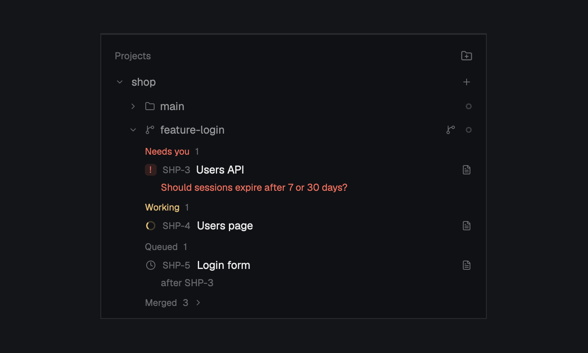

# Coordinator

Coordinator adds a sidebar section labelled Projects, beside Spaces and Agents, that shows your
coding projects as a tree. Each project is a git repo, under it are its worktrees, each with its own Claude Code coordinator
agent, and under each worktree are its tasks, grouped by what they need from you: Needs you,
Working, Queued, To do, Failed, Not merged and Merged. Click a worktree to go to its coordinator,
which starts if it isn't running. Click a task to peek at its worker's terminal or read its log.
Red marks show what's waiting on you, and spinners show what's running. The section is the front
end of the `hcoord` command-line tool, and it says how to get that tool until it's installed.



## What you see

One column on the `chrome` background with a 1px `border` line along the top, base type 13px.
Every color here is a `theme()` name, so the section follows the theme. "15% tint" means the color
at alpha `26` (hex) as a background. Top to bottom:

- **Header**, 41px tall, 16px side padding, 14px above and 5px below. The word `Projects` at 11.5px,
  medium, `dim`, on the left. On the right a 14px folder-plus icon, `dim`, `foreground` under the
  pointer, tooltip `New project from a folder`. The icon is hidden in the not-set-up state.
- **Not-set-up notice**, only when the CLI can't be run. 16px side padding, 8px below, 6px gap,
  12px `dim`: `Projects needs hcoord's CLI. Install it, then run hcoord mod install.`, then the URL
  `https://github.com/jonathan-fielding/herdr-project-coordinator` in `muted`, `foreground` under
  the pointer, tooltip `Open the install steps`.
- **Error line**, when the last load failed: `hcoord: <the error>`, 12px `blocked`, 16px side
  padding, 6px below.
- **Warning rows**, one for each warning from the CLI. 24px tall, 8px margin and 8px padding at the
  sides, 6px below, radius 6, 12px `blocked`, `hover` background under the pointer, tooltip
  `Click for more`. A truncated line, then an 11px chevron-right. A warning about a temporary folder
  reads `Data folder is temporary: it may be emptied`; any other shows its own text.
- **Empty line**, once loaded with no projects, 12px `dim`, 16px side padding: `No projects yet. The
  folder button makes one from any folder, and offers to set up git if it needs it; each of its
  worktrees gets a coordinator agent you talk to.`
- **The list** fills the rest, scrolling, 8px side padding, the scrollbar always shown.

Rows in the list, all radius 8 and `hover` under the pointer unless noted:

- **Project row**, 30px tall, 6px side padding, 6px gap. A 16px fold button (radius 4, `dim`, an
  11px chevron-down when open, chevron-right when folded, `hover` background and `foreground` under
  the pointer), the project's name truncated in medium weight (`foreground` when the focused space
  is in this project, else `muted`), when folded a red count of tasks needing you, then an 18px
  plus button.
- **Trust row**, under the project row when Claude doesn't trust the repo. 22px left and 8px right
  padding, 3px vertical, 11.5px `blocked`: `Claude doesn't trust ~/path yet`.
- **Bring-back row**, under an open project row and any trust row, when more than one of its
  coordinators is stopped by a restart. Same padding and type: `3 coordinators stopped: bring back`,
  or `Bringing coordinators back…` while it runs.
- **Worktree row**, 28px tall, 22px left and 6px right padding, 6px gap, `selected` background when
  it's the focused space. The fold button, a 12px `dim` icon (folder for the main checkout,
  git-branch for the rest), then the branch, or the folder's name if detached, truncated: `dim` when
  the worktree is gone, `foreground` when its coordinator runs or it's the focused space, else
  `muted`. Then when folded the working count (11px `working`) and the red count. Then an 18px
  git-branch button when the row can raise a PR, an 18px file-text button when the coordinator has
  a session, and the coordinator's status mark last.
- **Notice rows** under an open worktree, 44px left and 8px right padding, 3px vertical, 11.5px:
  `Coordinator reports no status: look at it` in `unknown` with an 18px square-pen button at the
  end, and `2 workers lost: carry on` (`1 worker lost: carry on`) in `blocked`. Above them, and on a
  folded worktree too, because they're what the person has to act on, one of two in `unknown` with no
  button: `Stopped by a restart: click to bring back`, or the occupied line: `Plain Claude running, not
  the coordinator` when `coordinatorProgram` is `claude`, `<program> running, not the coordinator` for
  any other program, and `Something else is running in its terminal: exit it first` when it's null.
- **Empty worktree line**, 11.5px `dim`, same padding, no hover, one of: `No tasks yet: tell the
  coordinator what to do.` (coordinator running), `Not checked out: click to check it out and start
  a coordinator.` (default branch with no checkout), `No tasks yet.` (registered, coordinator not
  running), `No coordinator yet: click to start one.` (never opened).
- **Group header**, 20px tall with 3px padding above, 44px left and 8px right padding, 6px gap, 11px
  medium: the label in its color, then the count in `dim`. Merged also has an 11px `dim` chevron and
  turns `foreground` under the pointer.
  Label colors: Needs you, Failed and Not merged `blocked`; Working `working`; Queued, To do and
  Merged `dim`.
- **Task row**, 44px left and 6px right padding, 3px vertical, 1px gap, two lines. Line one, 7px gap:
  the state mark, the id at 11px `dim`, the title truncated (`foreground`, `muted` when merged or
  cancelled), an 18px file-text button when it has a log. Line two, only with a note, 19px indent,
  11.5px truncated: `blocked` for Needs you and Not merged, else `dim`.
- A 4px spacer ends each open worktree.

Marks: an 18px icon button is radius 4, `dim` with a 12px icon, `hover` background and `foreground`
under the pointer. A badge is at least 14px wide, 14px tall, 3px side padding, radius 4, 10.5px bold
in the color on its 15% tint. A pill is 18px tall, 6px side padding, radius 5, 10.5px semibold, in
the same colors. A dot is 7px, radius 4, 3px side margin. A state icon is 12px, 1px side margin.

**On the sidebar's narrow rail** (the block `sidebar` under 160px) there's no header and no notices.
The list has no side padding and each project is one 26px row, 8px side padding, 4px gap, square
`hover`: its task prefix right-aligned at 11px `muted`, then a 14px slot holding the red count, or a
12px `working` spinner, or a hollow dot (a stopped coordinator has no mark of its own here). Below the list a 28px row is centered on the folder-plus
icon, or on a 14px `minus` icon when not set up.

**The log pane** opens to the right: the `background` color, markdown at 13px, 18px side and 12px
vertical padding, selectable and scrolling. `Loading…` until the first answer.

**The right-click menu**, a popup 210px wide and as tall as its items (160px at most): `popover`, 5px
padding, 12.8px type. Rows 31px tall, 8px side padding, 9px gap, radius 7, a 14px icon then the
label, the icon `muted`. Danger items are `blocked`, icon too, with a 1px `border` divider above (7px side and 4px vertical
margin) unless they're first. Disabled items are `dim`. The highlighted row is `selected`.

**Dialogs**: `popover`, 18px padding, 12px gap, 13px type. Title at 15px semibold `foreground`, with
`Esc` at 11px `dim` on the right. Buttons at the bottom right, 8px gap, 12px type, 32px tall, 14px
side padding, radius 8, a 1px border. Cancel and Close have an `input` border, the others a border of
their own background. All go to 88% opacity under the pointer; a button that isn't ready sits at 50%.

- **Delete worktree**, 460×300: buttons Cancel (`raised`, `foreground`) and Delete worktree (`blocked`,
  `#ffffff`).
- **Delete project**, 480×360: Cancel, Remove from Herdr (`solid`, `solid_foreground`) and Delete
  files too (`blocked`, `#ffffff`). The text has two headed parts, `Remove from Herdr` in medium
  `foreground` and `Delete files too` in medium `blocked`, with a 6px space between them.
- **New worktree**, 460×420: title `New worktree of <name>`, the line `A new branch, checked out in a
  space of its own with its coordinator.` in `muted`, then two fields, Branch and Start from, labels
  11.5px `dim` over 4px gap. Fields are 32px tall, 10px side padding, radius 6, a 1px border
  (`accent` when focused, else `input`), on `background`. Start from is a button with the chosen
  branch, an `origin` or `default` tag at 11px `dim`, and ▾ (▴ when open). Open, it adds a 30px filter
  field and a bordered scrolling list of 28px rows, the chosen branch in `accent`, the highlighted
  row `selected`. Buttons Cancel (`raised`) and Create (`solid`).
- **Where hcoord keeps its data**, 520×400: selectable, scrolling markdown, then Show in Finder
  (`raised`) and Close (`solid`). A warning about a temporary folder explains what's in the folder,
  why it's at risk, how it got there and the fix. Any other warning shows only its own text.

## How it behaves

**Coordinator status**, the mark at the end of a worktree row:

| Coordinator | Mark |
|---|---|
| Not running | hollow 7px dot, 1.5px `dim` border at 50% |
| Being opened from here | 12px `dim` spinner |
| Stopped by a restart (`shell`) | 12px `square` icon in `unknown` |
| Something else in its terminal (`occupied`) | 12px `terminal` icon in `unknown` |
| working | 12px `working` spinner |
| blocked | `Needs you` pill in `blocked` |
| done | filled 7px dot in `done` |
| idle | hollow 7px dot, 1.5px border in `idle` (`dim` if the theme has none) |
| Running, no agent status (at a prompt, or still starting) | `?` badge in `unknown` |

Spinners turn once every 900 ms, natively. Nothing else animates.

**Task states**, under each worktree, in group order:

| State | Group | Mark | Line two |
|---|---|---|---|
| needs_you | Needs you | `!` badge, `blocked` | the reason |
| starting, working | Working | `working` spinner | none |
| queued | Queued | clock, `dim` | `after HCM-1, HCM-2` when waiting on tasks |
| todo | To do | hollow dot, 1.5px `dim` border | none |
| failed | Failed | x, `blocked` | the report's first line |
| done | Not merged | git-compare, `blocked` | `not merged: <why>`, or `merging…` |
| merged | Merged | check, `done` | the report's first line |
| cancelled | Merged | minus, `dim` | none |

Merged is folded for each worktree until its header is clicked, shows newest first when open, and
forgets being open on reload. The other groups never fold. Reasons and summaries lose a trailing
`; hc read t7` or `; hcoord task retry …`, because the rows are the way to do those.

**Counts**: "needs you" counts `needs_you` tasks plus `done` tasks with a merge error. "Working" counts
`starting` and `working` tasks.

**Clicks**

- Project row: folds or unfolds it. Plus button: the New worktree dialog.
- A project with no saved fold state starts open when the focused space is in it, when something needs
  you, when a coordinator of its is stopped, or when it's the only project. A worktree starts open when it's the focused space, or has
  tasks needing you or working. Clicking a fold saves it.
- Worktree row: goes there. If the coordinator runs, `agent.focus`. Otherwise it selects the
  worktree's space if there is one and starts or resumes the coordinator there; with no space, the
  coordinator starts in a new one named `<project>` for the main checkout or `<project> · <branch>`.
  The row shows the spinner meanwhile, and a failure is an error toast for 12 s. A row whose worktree
  is gone does nothing. A stopped coordinator goes the same way and `lane open` resumes it, in the
  space that holds its pane, so that space is used even when no folder matches. With something else in
  its terminal the click only does `terminal.peek`. One at a prompt reporting no agent gets the toast,
  because `lane open` refuses without `--restart`; its notice row is the way in.
- The default branch with no checkout appears as a row anyway: clicking it checks the branch out
  where Herdr puts worktrees (`~/.herdr/worktrees/<repo>/<branch>`), then goes there.
- Worktree order: the default branch first, then the main checkout if it's on another branch, then
  the rest by name. Registered worktrees that have disappeared stay listed while they have active
  tasks.
- Raise PR button, on a worktree with a branch other than the default one: types `Raise a PR for this
  worktree's branch (<branch>) against <default>.` to its coordinator, starting one if needed, then
  shows the toast `Asked <branch>'s coordinator` for 6 s. It goes through `lane say`, which brings a
  stopped coordinator back first and refuses if something else runs in its terminal; that refusal is
  the error toast.
- A file-text button opens the log pane to the right. On a worktree row it's the coordinator's log; on
  a task row, the task's.
- Task row: `terminal.peek` when its worker's terminal is live, else the log if it has one, else
  nothing. Only the first two get the pointer cursor and hover.
- `Coordinator reports no status`: peeks at it. Its square-pen button replaces it with a fresh Claude
  carrying on the conversation, through `lane open --restart`.
- `Stopped by a restart`: the same as clicking the worktree row.
- The occupied line: `terminal.peek`. There is no replace button, and nothing in the mod
  stops that terminal.
- `N coordinators stopped: bring back`: runs `lane open <path> --no-focus --json` for each stopped
  coordinator in turn, in its own space if it has one, else a new one. It selects no space, so the
  person stays where they are, and one failure is an error toast `Couldn't bring back <name>` while the
  rest carry on.
- `N workers lost: carry on`, shown for failed tasks whose summary says the terminal `no longer
  exists`: retries each one.
- Trust row: a new tab named `trust <repo folder>` running `claude` in the repo, to answer its prompt.
- Warning row: the data dialog. Show in Finder opens the data folder.
- Folder-plus: the system's folder picker with the prompt `Make project`, then the folder's repo
  becomes a project named after the folder, unfolded, and that checkout's coordinator starts. A folder
  already in a project just goes there. If Claude doesn't trust the repo, a warning toast shows for
  15 s. A folder in no git repo opens the git dialog instead. If that can't be offered (say the name is
  taken), or `project new` fails any other way, a 12 s error toast `Couldn't make <name> a project`
  gives the reason.
- Rail row: goes to the main checkout's coordinator.

**Right-clicks**

- Project: New worktree, Delete project….
- Worktree: Raise PR (when it can), Coordinator's log (when it has a session), then Delete worktree….
  On the main checkout that last item is the disabled line `Main checkout: delete the project
  instead`. A default branch with no checkout has no menu.
- The menu has the keyboard: ↑ ↓ move, Enter chooses, Esc closes. A disabled item ignores Enter.

**Drag to reorder**: press a project row (or rail row) anywhere but its buttons and drag onto another.
The dragged one goes to 50% opacity and a 2px `accent` line, radius 1, shows where it lands: at the
bottom edge of the target when moving down, the top when moving up. Letting go on a project moves it
there and saves the order. Letting go anywhere else in the list, or leaving the list, cancels. Saved
projects come first in saved order, new ones after them in the CLI's order.

**Hovers**: project, worktree, task and notice rows and every icon button have tooltips. A project shows `<name>: ~/path`. A worktree
shows its path and `Click: show its coordinator`, `Click: start its coordinator` or `This worktree is
gone`; a stopped one `Stopped by a restart. Click: bring it back, carrying on its conversation` (`as a
new conversation` when it has no session). An occupied one, and its line, show `This Claude was started
by hand and isn't the coordinator. To bring the coordinator back, /exit it, then click the worktree. The
coordinator's saved conversation comes back, not this session, which stays in its own transcript. Click:
look at it` (with no session, `That starts a new conversation. This session stays in its own transcript.`
in place of the third sentence); for another program `<program> is running in the coordinator's terminal.
Exit it first, then click the worktree to start the coordinator. Click: look at it`, and with
`coordinatorProgram` null the same with `Something else` for `<program>`; the unchecked-out default branch says what a click will do. A task shows `<id> <title>` and `Click: peek at its terminal` or `Click: its log`.

**Dialogs**

- Delete asks hcoord for a dry run first, showing `Looking…`, and its action buttons stay at 50% until
  the plan arrives. Worktree: `~/path goes, with its Herdr space. The branch <b> is kept.`, the
  uncommitted files in `blocked` (first four named), `Its coordinator is stopped.` if one runs,
  unfinished tasks in `blocked`. Project: what Remove from Herdr does, including where tasks and logs
  move, then what Delete files too removes, line by line, with uncommitted counts and unpushed commits
  in `blocked`, and whether files go to the Trash or are deleted for good.
- Confirming shows `Deleting…`. It closes the affected spaces first, then runs hcoord, then closes the
  dialog with an 8 s toast of the output's last three lines. An uncommitted worktree is removed with
  force, since the dialog already warned. An error stays in the dialog in `blocked`. Esc closes it.
- New worktree: Branch has the focus. Enter in a field creates. Start from loads the repo's branches,
  reading `Loading branches…` until then, with the default selected. If that fails it's a plain text
  field with the default branch as its placeholder (`the main checkout's HEAD` when there is none). ↓
  in Branch or a click opens the list, typing filters it, ↑ ↓ move, Enter or a click chooses, Esc
  closes the list and then the dialog. No match shows `No matching branches.`. An empty name shows
  `Type a name for the new branch.`. Create shows `Creating the branch and its checkout…` then
  `Starting its coordinator…`, closes the dialog and goes to the new space with one `agent.focus`, so
  the window moves only once it's ready.
- Git dialog, 520 by 460: `Set up git in <name>?`, then `~/path isn't a git repo yet. Workers each get
  a checkout of it, and for that it needs a first commit of its files.` With no `.gitignore` and files
  to commit, a `blocked` line: `There's no .gitignore, so everything listed gets committed, including
  things like node_modules or .env.` Then `N files will be committed:` (or, with none, `The folder has
  no files to commit, so the first commit will be empty.`) over the files in a scrolling list, ending
  `and N more` when the dry run's list is shorter than its count. Cancel (`raised`) and Set up git
  (`solid`). Only that click commits; Enter does nothing. It shows `Setting up git…`, with both buttons
  at 50% and Esc ignored, since a commit under way can't be called back. An error stays in the dialog
  in `blocked`. On success the sidebar copy carries on as for any new project: the trust toast, the
  project unfolded, its coordinator started.
- Data dialog: Esc or Enter closes it.

**The log pane** reloads every 30 s and whenever the folder of its transcript changes, so it follows
the agent as it works. A failure shows `Couldn't read the log: <why>`.

**Things it does unprompted**

- The list refreshes when anything under the data folder's `projects/` changes, and every 8 s. Each
  refresh is one `hcoord board --json`.
- When a watched terminal (a coordinator, or a worker of an active task) changes state, it runs
  `hcoord sync`, which marks exited workers and starts queued tasks, then refreshes. Not on first load.
  It never restarts a lost worker: that's `N workers lost: carry on`, or `hcoord recover`.
- Switching to a space in a project's worktree starts its coordinator if it isn't running, without
  moving focus, at most once a minute per worktree. That includes resuming a stopped one, but never a
  terminal with something else running in it. A space not known yet is looked at again after each
  refresh.
- Nothing resumes by itself at Herdr start, because each resume uses a Claude turn. The first space
  focused after the mod loads isn't a switch, even if the focus or the board arrives late, so it waits
  for a click or a later switch. Nor is the focus moving while a coordinator is being replaced: no
  switch starts anything while a worktree is being opened, and a real switch in that moment waits for
  the next one.
- A new local space in a git repo no project has gets one toast, `Make <repo> a project?`, for 15 s;
  clicking it sets the project up. It asks once per repo, ever. A space inside a project's repo but in
  a checkout it doesn't know triggers a refresh instead. Spaces are first checked after 2 s, or up to
  6 s while their folder is unknown. Spaces at home, in the data folder or in workers' checkouts are
  skipped.

**Not set up**: with the default `hcoord-path.js`, or when running the CLI fails outright (exit 126 or
127, the program won't start, or Bun can't find `cli.ts`), the notice shows and the folder-plus is
gone. The notice's link opens the install page. With the default file the mod never tries to run
anything; a new `hcoord-path.js` reloads it. After a failure it tries again every 60 s, and projects
already loaded stay on screen. Any other failed `board` run is the red error line, not this state.

## Built from

- `mods/hcoord/main.js`: one default-export `View`, class `Projects`. It ships no `keys.json`.
- `mods/hcoord/mod.json`: `{ "place": "none", "title": "Coordinator", "overlay": { "width": 300,
  "height": 480 } }`.
- `mods/hcoord/hcoord-path.js`: `export const HCOORD = null;` as committed; see Watch out.
- One mod plays several roles, chosen by `props()` in this order in both `init` and `render`. Each
  role returns early, so only the sidebar copy has timers and the command loop:

  | Prop | Role | Opened with |
  |---|---|---|
  | `log` | log pane; a task id, or `{ project, lane }` for a coordinator | `pane.split {direction: "right", mod: "hcoord", props}` |
  | `menu` | right-click menu; `{ kind: "project" \| "worktree", … }` | `openOverlay`, `kind: "popup"`, 210×160 |
  | `ask` | delete dialog; `{ what: "project" \| "worktree", … }` | `openOverlay`, `kind: "dialog"`, 480×360 or 460×300 |
  | `info` | data dialog; `{ warning, root, worktreeRoot }` | `openOverlay`, `kind: "dialog"`, 520×400 |
  | `newWorktree` | New worktree dialog; `{ project, name, defaultBranch }` | `openOverlay`, `kind: "dialog"`, 460×420 |
  | `gitInit` | git dialog; `{ name, folder, plan }`, `plan` being the dry run below | `openOverlay`, `kind: "dialog"`, 520×460 |
  | none | the section | a layout block |

- Shipped mods used: only `workspace-chrome`, for its icons. Nothing of its code.
- Imports. `gpui-kit`: `View`, `div`, `svg`. `gpui-base`: `v_flex`, `h_flex`, `TextView`, `InputState`,
  `Input`, `Scrollbar`.
- `herdr` functions: `agents`, `terminals`, `panes`, `spaces`, `focused`, `layout`, `theme`, `home`,
  `props`, `run`, `exec`, `notify`, `nextCommand`, `pickFolder`, `watchFolder`, `openOverlay`,
  `closeOverlay`, `shared`, `setShared`. Also `localStorage`, and `cx.open_url` for the setup link.
- Commands through `run`: `agent.focus {terminal}`, `space.select {id}`, `space.rename {id, name}`,
  `space.move {id, index}`, `space.close {id, confirmed: true}`, `terminal.peek {terminal}`, `tab.new {name, folder, argv: ["claude"]}`, `pane.split
  {direction, mod, props}`, its own `hcoord.raise-pr`, and its own `hcoord.project-made`.
- Commands it receives through `nextCommand()`: `new` (the folder-plus flow; nothing ships a key for
  it), `adopt` (the toast's `action: { name: "hcoord.adopt" }`), `raise-pr` (from the menu copy, which
  first does `setShared("hcoord.raise-pr", { project, path })`; the sidebar copy reads it and clears it),
  `project-made` (from the git dialog copy, the same way with `setShared("hcoord.project-made", { folder,
  name, text, stdout })`).
- Programs run through `exec`:
  - `HCOORD[0]` with `HCOORD.slice(1)` and the hcoord arguments below.
  - `git rev-parse --path-format=absolute --git-common-dir` with `cwd` at a new space's folder.
  - `open <data folder>` from Show in Finder.
  - The mod doesn't call `hc`, and `tab.new` runs `claude` only for the trust row.
- `hcoord` calls. Add `--json` where shown. Non-zero exit means failure; the text shown is stdout plus
  stderr, trimmed.
  - `board --json`, shape below.
  - `sync`.
  - `lane open <path> [--space <id> | --new-space <name>] [--restart] [--no-focus --json]`. The JSON
    form gives `{ project, lane, ok, terminal, lines }`. What it does depends on `coordinatorState`:
    - `running`: shows it. `--restart` changes nothing, so a working coordinator is never replaced.
    - `shell`: stops the shell and resumes, no flag needed.
    - `none`: starts or resumes.
    - `prompt`: fails with a message saying to look at it. With `--restart`, replaces it and resumes.
      A coordinator whose record was lost is replaced without the flag.
    - `occupied`: fails, with or without `--restart`, naming what runs there and saying to exit it. For
      Claude it says a plain Claude started by hand is there, to `/exit` it, and whether the saved
      conversation or a new one comes back.
      **A terminal with something else running in it is never killed.**

    Resuming uses the saved session when its transcript still exists, otherwise a new session.
  - `lane say <path> <text> [--space <id> | --new-space <name>]`.
  - `lane checkout <branch> <slug> --json` and `lane new <branch> <slug> [--base <ref>] --json`, both
    `{ project, lane, path, branch, created }`, `lane new` also `base`.
  - `lane branches <slug> --json`: `{ default, selected, branches: [{ name, ref, remote }] }`, where
    `selected` is the default's `ref`.
  - `lane remove <path> --dry-run --json`: `{ path, branch, changed: [file], coordinator, unfinished:
    [id], … }`. Then `lane remove <path> [--force]`.
  - `project new <name> --repo <folder> [--git-init] --json`: the project with its `slug`. A stderr
    line starting `warning:` is the trust warning.
  - `project new <name> --repo <folder> --git-init --dry-run --json`: `{ repo, gitInit, files, count,
    hasGitignore }`. `files` is capped at 200; `count` is all of them. Run when `project new` fails with
    `not a git repository`.
  - `project delete <slug> --dry-run --json`: `{ checkouts: [{ path, changed }], workerDir, unpushed,
    unfinished: [id], coordinators: [address], archive, trash, … }`. Then `project delete <slug>
    [--files]`.
  - `settings show <slug> --json`: `{ cleanupPrompt }`, `""` when none is set. A missing or older
    `settings.json` gives the defaults.
  - `settings set <slug> --cleanup-prompt-file -`, with the text on stdin. Surrounding whitespace is
    trimmed and empty text clears it.
  - `task retry <id>`.
  - `log <id> --json` and `log --lane <key> <slug> --json`: `{ markdown, transcript }`, with `transcript`
    the file's path or null.
- `hcoord board --json`:

  ```text
  { version: 2, root, worktreeRoot, agent, warnings: [string], projects: [{
      slug, name, prefix, repo, dir, trusted: true | false | null,
      lanes: [{ key, path, branch, present,
                coordinator: { address, name, session? } | null,
                coordinatorState: "running" | "prompt" | "shell" | "occupied" | "none",
                coordinatorProgram: string | null }],
      checkouts: [{ path, branch }],
      defaultBranch: { name, path, checkedOut } | null,
      tasks: [{ id, title, state, lane, hasLog, waitingOn: [id], updatedAt,
                reason?, summary?, mergeError?, terminal? }] }] }
  ```

  `state` is one of `todo`, `queued`, `starting`, `working`, `needs_you`, `done`, `merged`, `failed`,
  `cancelled`. `terminal` and `coordinator.address` are hc addresses, matched against `terminals()`
  and `agents()`. A coordinator is live only if a live terminal has both its address and its name, and
  its `coordinatorState` isn't `shell` or `occupied`. In those two, ignore any agent Herdr reports in
  the terminal: a Claude started by hand in that shell isn't the coordinator.
- `coordinatorState` says what became of a coordinator, read from the recorded terminal:
  - `running`: hcoord's agent, reporting a status.
  - `prompt`: hcoord's agent reporting no status (Claude's trust question, or still starting).
  - `shell`: stopped by a restart. A coordinator's terminal is kept, so after a reboot or a lost
    program it comes back as a shell with the same name, and nothing runs there. It counts from the
    moment the program is lost, before the shell has started.
  - `occupied`: replaced by that shell, and something else runs in it now, or the foreground isn't
    known yet (a new shell shows none for a moment, so a rerun clears that).
  - `none`: no such terminal running, or the core can't be reached. A lost record also reads as this.

  `coordinatorProgram` is set only for `occupied`: the foreground program's name, `argv[0]`'s basename
  such as `vim`, or `claude` for Claude. It's null when the foreground isn't known. `foreground.name`
  can't be used, as it's Claude's version number. `status.app` of `claude-code` also means Claude, but
  only when `argv[0]` is `node`, `bun` or a version number, because any other program may just have a
  status left from what ran there before.

  Replaced means a kept terminal whose argv no longer starts `env … HCOORD_PROJECT=<slug>`. Status
  can't tell, because a Claude started by hand reports one too.
- A task's lane is `lanes[].key`. A worktree row comes from `checkouts`, joined to `lanes` by `path`. A
  space maps to a worktree through its first terminal's `cwd` (`panes()`), else `space.folder`, picking
  the deepest checkout containing it and ignoring anything under `worktreeRoot`.
- Icons, all `mods/workspace-chrome/<name>.svg`, tinted by text color: `spinner`, `x`, `git-compare`,
  `check`, `minus`, `clock`, `chevron-right`, `chevron-down`, `folder`, `folder-plus`, `git-branch`,
  `file-text`, `square-pen`, `plus`, `square`, `terminal`.
- Saved in `localStorage`: `open` (`p:<slug>` and `w:<path>` to true or false), `dismissed` (repos
  already offered), `order` (project slugs). Timers: 8 s refresh, 1.5 s new-space look, 30 s log reload.

## Watch out

- **What this mod reaches.** Before adding it, tell the person:
  - It runs programs: `bun` with the hcoord CLI, `git` and `open`, plus `claude` in a new tab from the
    trust row. It doesn't call `hc` itself. The CLI it runs does call `hc`, `herdr-app`, `git`,
    `/usr/bin/trash` (Delete files too) and, through `hc`, `claude`, so it starts Claude Code agents
    on its own: a coordinator when you switch to a project's space (never at Herdr start), and workers
    when `hcoord sync` finds queued tasks that can run.
  - It reads outside its folder. The mod watches `~/.herdr-coordinator/projects` (or the `root` the CLI
    reports) and the folder holding a shown transcript, normally under `~/.claude/projects`, and uses
    icons from `mods/workspace-chrome`. It opens no files itself: the CLI reads and writes
    `~/.herdr-coordinator`, reads `~/.claude.json` and transcripts, and makes checkouts in
    `~/.herdr/worktrees`.
  - It changes things on disk when asked: delete dialogs run `git worktree remove`, and Delete files too
    moves a repo and its checkouts to the Trash, or deletes them for good where `/usr/bin/trash` is
    missing.
  - Network: the mod makes no network requests; the setup link opens in the browser. The only network
    use the CLI makes itself is a `git fetch` of one branch from origin, limited to 15 s
    (`HCOORD_FETCH_TIMEOUT_MS` overrides that). `lane new` fetches its base branch every time, and
    fast-forwards a local base that is behind origin's and not checked out anywhere. `lane checkout`
    fetches only a branch with no local copy. A fetch that fails or times out doesn't block: the CLI
    prints a `warning:` line on stderr, which the mod doesn't show, and carries on with the local copy.
    The agents it starts are full Claude Code sessions that use Anthropic's service, and Raise PR has a
    worker run `git push` and `gh pr create`.
- **`"place": "none"` means nothing appears after copying.** Add the section to a layout. Never edit a
  shipped layout, they're replaced on update; clone first with `herdr-app do layout.clone
  '{"name":"main","as":"main-plus"}'`. Then in `layouts/main-plus.json` add this to the sidebar column,
  between the `spaces` and `agents` blocks:

  ```json
  { "id": "projects", "type": "block", "content": { "mod": "hcoord" }, "size": { "weight": 1 }, "min": 90 }
  ```

- **The CLI is a prerequisite, and this recipe doesn't build it.** Install it from
  https://github.com/jonathan-fielding/herdr-project-coordinator per its README, with its own
  prerequisites: macOS, the Herdr app with `hc` on the PATH, Claude Code signed in, git and Bun. `open`
  and Trash handling are macOS's.
- **`hcoord-path.js` is how the mod finds the CLI.** Keep the literal `export const HCOORD = null;` in
  the plain folder. `hcoord mod install` writes an argv array there in the installed copy, e.g.
  `["/Users/me/.bun/bin/bun", "/Users/me/herdr-project-coordinator/src/cli.ts"]`, and `HCOORD_HOME`
  goes in front through `/usr/bin/env HCOORD_HOME=…`.
- **`exec` can't rely on PATH.** `exec` has no environment option, and the `hcoord` shim lives in
  `~/.local/bin`, which the app's PATH need not include. So never `exec("hcoord", …)`: run the exact
  bun and `cli.ts`, and `exec` can't set `HCOORD_HOME` either. Moving the clone breaks this, which is
  why Bun's `Module not found` and `Cannot find module` count as not set up, as well as 126 and 127.
- **`hcoord mod install` overwrites a build.** It copies the clone's `mods/hcoord/` over
  `~/.config/herdr-app/mods/hcoord`, so a from-scratch build is replaced by the repo's files. To keep a
  build, write `hcoord-path.js` by hand instead. It also refuses a folder it doesn't recognize unless
  that folder has `.hcoord-installed` or `HCOORD = null`, and refuses a temporary data folder.
- **The name `hcoord` is hard-coded**: in `openOverlay`, `pane.split`, the `hcoord.adopt`,
  `hcoord.raise-pr` and `hcoord.project-made` commands, the install target, and the layout block.
  Rename all of them together, or not at all (the install always writes `mods/hcoord`).
- `exec` rejects when the program can't start: catch it and treat it as not set up. `hcoord()` must never
  reject, because every caller assumes that.
- Read JSON from stdout alone. Warnings go to stderr, so parsing the combined text fails.
- Never run `hcoord sync` from a board refresh. `board` writes nothing; `sync` does, and that fires the
  `projects/` watch. Start syncs only on a changed terminal signature, and skip the first one, or every
  reload syncs.
- `watchFolder` rejects until `projects/` exists. Stop the loop, clear the flag, and let the timer start
  it again on a later refresh. The timer also has to catch what the watch can't see: Claude's trust list,
  new git worktrees and branch switches.
- Dragging: a press on a button inside a project row must not start a drag. The button's mouse-down runs
  first and records the position; the row's handler skips a press at that same position. Don't use
  `stop_propagation` for this.
- Replacing a coordinator can close its space. `lane open` kills the old terminal before starting the
  new one, and a space's only tab going closes the space. Herdr makes it again with the same id but
  unnamed and last, and the focus lands elsewhere. So note the space's name and index first, then
  restore them with `space.rename` and `space.move`. After a bring-back, `agent.focus` the new terminal
  if the person was on that space. Don't let that focus change count as a switch, or it starts another
  coordinator.
- Find a stopped coordinator's space from its pane. A shell reports no agent, and the folder match can
  pick the wrong space or none.
- Never stop a coordinator's terminal from the mod. Only `lane open` and `recover` replace one, after
  checking that nothing else runs there. The one exception is what the person confirms in a delete
  dialog: `lane remove` and `project delete` stop the terminal whatever runs in it.
- Don't call `space.new` for a worktree with no space, or a shell shows first. Use `lane open --new-space`
  so Herdr makes the space around the coordinator.
- New worktree: focus Branch in `init` and again after 600 ms, if it's still the field in use. Pass `--base` only when the choice differs from `selected`, so the CLI picks local or origin's.
- Menu items must close the overlay before acting. The menu is another copy of the mod with no board data,
  so it passes Raise PR to the sidebar through shared state and a command; with two sidebar copies, the
  first to read it clears it.
- `localStorage` belongs to one copy of the mod, so folds and order aren't shared with a copy in another
  layout.
- Delete closes spaces before running hcoord, so no shell sits in a folder that's going. If hcoord then
  fails, the spaces are already closed.
- The toast acts on the latest offer only, and the repo is marked as asked once offered, whether or not
  it's clicked. The folder button still makes it a project.
- `.when()` takes a boolean, so wrap strings in `Boolean()`. Elements need `.id()` before `.hover()`,
  or `.on_click()`. Spinners use `.spin(900)`, never a timer.
- A theme might have no `idle` color: fall back to `dim`.
- Only one data warning is known by name: match `/temporary folder/` for the short label and the full
  explanation. A warning row's dialog shows `Where hcoord keeps its data` as its title for any warning.

## Done when

- `herdr-app check ~/.config/herdr-app/mods/hcoord` passes with `HCOORD = null`.
- With the layout block added, a `Projects` section sits between Spaces and Agents, showing the install
  line and the URL, no folder-plus, and no `hcoord` process runs. Clicking the URL opens the repo page.
- With the sidebar narrowed to its rail, under 160px, the header is gone and the `minus` icon sits below
  the list.
- With the CLI installed and `hcoord-path.js` holding its argv, the section reloads by itself and the
  notice goes. `herdr-app check` still passes.
- With no projects it shows the `No projects yet.` line. The folder-plus opens a folder picker prompted
  `Make project`. Picking a git folder makes a row named after it and starts a coordinator in that checkout.
- The rows match `hcoord board --json`: every project, every entry in `checkouts`, every task in the group
  for its state, in the group order above. A task added with `hcoord task add` appears at once, without
  waiting for the 8 s timer.
- A worktree's mark follows its coordinator: spinner while it works, `Needs you` at a prompt, filled dot
  when it finishes, hollow once looked at.
- Clicking a worktree with no coordinator starts one and shows its space. Clicking again focuses it.
- Switching to a project's worktree space with no running coordinator starts one, once a minute at most.
- After a restart (`hc server stop`, then `hc server start`) nothing resumes when Herdr comes up, even with
  the sidebar reloaded. Each stopped worktree shows the square and `Stopped by a restart: click to bring
  back`, even folded, and `hcoord board --json` gives `coordinatorState: "shell"`. Clicking one resumes its
  conversation in its own space, with the space's name and place kept. With two stopped, `2 coordinators
  stopped: bring back` resumes both and the focus stays put.
- With something running in a stopped coordinator's terminal, the row shows the `terminal` mark and `Something
  else is running in its terminal: exit it first`. A click, a space switch, `lane open --restart` and
  `recover` all leave it running. Once it's exited, clicking resumes the coordinator.
- A task's file-text button opens a log pane on the right that grows as the agent works. Clicking a running
  task's row peeks at its terminal.
- Right-clicking a project shows New worktree and Delete project…; right-clicking the main checkout shows
  the disabled line. ↑ ↓, Enter and Esc work in the menu.
- New worktree with a branch name makes `~/.herdr/worktrees/<repo>/<branch>`, opens one new space with its
  coordinator, and lands there. `git worktree list` shows it.
- Delete worktree lists what goes and needs a confirm. Afterwards the folder and space are gone and the
  branch remains.
- Dragging one project over another moves it, shows the `accent` line, and the order survives a reload.
- After `HCOORD_HOME=<a temporary folder> hcoord mod install --temp`, the section shows a red `Data folder
  is temporary` row. Clicking it opens the dialog, and Show in Finder opens that folder.
- Pointing `hcoord-path.js` at a path that doesn't exist brings the notice back when the mod reloads.
